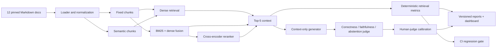

# Project guide: RAG evaluation harness

## The project in one sentence

This repository builds a small document-based RAG system and, more importantly,
an evaluation harness that measures **retrieval quality**, **answer
correctness**, **faithfulness**, **abstention** and **latency** separately while
comparing four retrieval pipelines under the same benchmark.

## The plain-language story

The original idea was to create about 50 questions for a documentation corpus,
try fixed chunking, semantic chunking, hybrid search and reranking, then automate
a regression check in GitHub Actions. That idea became a controlled experiment:

1. Twelve version-pinned FastAPI tutorial pages became the first corpus.
2. A 50-question benchmark was created with exact supporting quotes: 40
   development questions and 10 reserved questions.
3. Four retrieval configurations were implemented and compared only on
   development data.
4. Configuration B—semantic chunking plus dense retrieval—was selected because
   it returned complete evidence most often without reranker latency.
5. Answer judging was not trusted blindly. Human labels were saved before hidden
   judge verdicts, then exact agreement was measured.
6. The dataset, corpus, selected pipeline, prompts and judge were fingerprinted
   and committed before the reserved test.
7. The reserved split was run once and reported without tuning v1 from its
   failures.
8. A deterministic CI gate now rebuilds B and rejects retrieval regressions.

This is not merely “a chatbot.” The strongest part is the experiment discipline:
the project can show *where* a RAG answer failed instead of hiding everything
behind one vague accuracy number.

## What exactly is compared?

All configurations use the same 12 documents, questions, top-k value and metric
definitions. Only retrieval changes.

| Config | Pipeline |
|---|---|
| A | Fixed-size chunking + dense retrieval |
| B | Semantic chunking + dense retrieval |
| C | Fixed-size chunking + dense/BM25 reciprocal-rank fusion |
| D | Fixed-size chunking + hybrid retrieval + cross-encoder reranking |

Development selection result: B returned complete evidence for 29/36 answerable
questions, versus A 27/36, C 26/36 and D 27/36. D had slightly higher average
evidence coverage but was much slower and did not win the complete-evidence
objective. This is why “more complex” did not automatically mean “better.”

## Architecture and data flow

For one question, the sequence is:

1. Select the frozen benchmark row.
2. Embed the question and retrieve top-5 chunks from the selected index.
3. Save chunks and retrieval latency immediately.
4. Generate a context-only answer and save it as another checkpoint.
5. Score retrieval from exact gold sources and evidence quotes.
6. Judge the already saved answer—never regenerate it during judging.
7. Bind report signatures so changed inputs cannot silently reuse old results.

## Major files and components

| Path | Responsibility |
|---|---|
| `data/raw/` | The 12 frozen FastAPI Markdown documents. |
| `data/CORPUS.md` | Corpus origin, selection and normalization record. |
| `data/eval/questions.draft.jsonl` | The legacy-named but frozen 50-question benchmark. |
| `data/eval/benchmark-freeze-v1.json` | Machine-readable dataset, corpus, model, prompt and protocol fingerprints. |
| `data/eval/REVIEW.md` | All question/reference/evidence pairs and review history. |
| `src/ingestion/loader.py` | Loads Markdown/text and gives documents deterministic IDs. |
| `src/chunking/fixed.py` | Configuration A/C/D fixed-size chunks. |
| `src/chunking/semantic.py` | Configuration B embedding-change boundaries and size controls. |
| `src/retrieval/embeddings.py` | Pinned MiniLM embedding model and embedding functions. |
| `src/retrieval/index.py` | Builds persistent fixed and semantic Chroma collections. |
| `src/retrieval/dense.py` | Dense top-k vector retrieval. |
| `src/retrieval/hybrid.py` | BM25 + dense reciprocal-rank fusion. |
| `src/retrieval/rerank.py` | Pinned cross-encoder reranking for D. |
| `src/generation/answer.py` | Context-only answer prompt and refusal rule. |
| `src/generation/llm.py` | Replaceable Groq/Gemini HTTP clients and model choices. |
| `src/evaluation/validate.py` | Structural and exact-evidence benchmark validation. |
| `src/evaluation/run.py` | Signed, resumable capture with per-question checkpoints. |
| `src/evaluation/metrics.py` | Hit@K, MRR, source recall and exact-evidence scoring. |
| `src/evaluation/report.py` | Offline deterministic retrieval report. |
| `src/evaluation/judge.py` | Strict answer judge schema, retry checkpoints and prompt. |
| `src/evaluation/human_review.py` | Blind packet export, label parsing and agreement comparison. |
| `src/evaluation/answer_report.py` | Calibrated answer/latency report with contract matching. |
| `src/evaluation/compare_answers.py` | Paired A-versus-B answer comparison with confound checks. |
| `src/evaluation/gate.py` | Enforces the frozen development retrieval thresholds. |
| `quality-gate.json` | Expected B provenance, baseline values and allowed regressions. |
| `.github/workflows/retrieval-quality.yml` | Tests, rebuild, dev retrieval, gate and degradation proof. |
| `calibration/2026-11-14/` | Frozen mixed human labels and exact agreement evidence. |
| `reports/final-test-v1-2026-11-22/` | Versioned final retrieval and answer results. |
| `streamlit_app.py` | Saved-results dashboard and blind-review interface. |
| `.streamlit/config.toml` | Dual light/dark dashboard theme. |
| `tests/` | 72 functional tests across the evaluation system. |

## Experiment history and decisions

| Stage | Evidence | Decision/result |
|---|---|---|
| Baseline A | `reports/config-a-dev-draft-v2/` | Established retrieval metrics and showed page hits can hide missing evidence. |
| Dense vs hybrid | `reports/dense-vs-hybrid-dev-2026-11-11/` | C did not beat A on complete evidence. |
| Fixed vs semantic | `reports/fixed-vs-semantic-dev-2026-11-12/` | B improved complete evidence from 27/36 to 29/36. |
| Four-way comparison | `reports/four-config-dev-2026-11-12/` | B selected; D complexity/latency was not justified. |
| First calibration | `calibration/2026-10-26/` | 100% correctness and 78.6% faithfulness agreement on 14 answerable outputs. |
| A vs B answers | `reports/config-a-vs-b-calibration-2026-11-14/` | Both tied at 92.9%; no unsupported winner claim. |
| Mixed calibration | `calibration/2026-11-14/` | 100% exact agreement: correctness 8/8, faithfulness 8/8, abstention 2/2. |
| Benchmark freeze | `data/eval/benchmark-freeze-v1.json` | Test protocol committed before reserved evaluation. |
| Final reserved test | `reports/final-test-v1-2026-11-22/` | Retrieval page hit/MRR/source recall 100%; answer correctness and faithfulness 77.8%; abstention 100%. |

## Final result explained

There were nine answerable reserved questions and one unanswerable question.

- The retriever found a relevant page in the top five for 9/9 and ranked it
  first for 9/9.
- It captured every exact required evidence span for only 5/9. Correct page is
  therefore not the same as complete evidence.
- The generator was fully correct on 7/9 answerable questions.
- Every claim was grounded in retrieved text on 7/9.
- It correctly refused the one unsupported question.

Failure types:

- q021 and q045: useful context existed, but the model refused. These are
  **over-abstention/correctness** failures.
- q036 and q046: the answer matched the reference, but one fact was absent from
  retrieved context. These are **faithfulness** failures.

## Honest limitations

- The corpus has only 12 pages from one FastAPI domain.
- The reserved split has only 10 questions and is not cross-domain evidence.
- All 50 references were AI-assisted cross-checked against the sources, but the
  full item-by-item human checklist is incomplete.
- Mixed judge calibration uses one reviewer and ten outputs.
- LLM providers can change model behavior even when model names remain stable.
- Answer/latency reports exclude scheduling delay, model preload, judge time and
  failed-attempt time as documented.
- The full repository passes `ty check` and all 72 functional tests.
- This is a strong evaluation/reliability project, not a production RAG service.

For exact commands, continue with [RUNBOOK.md](RUNBOOK.md). For learning and
interview preparation, use [STUDY_AND_INTERVIEW.md](STUDY_AND_INTERVIEW.md).
